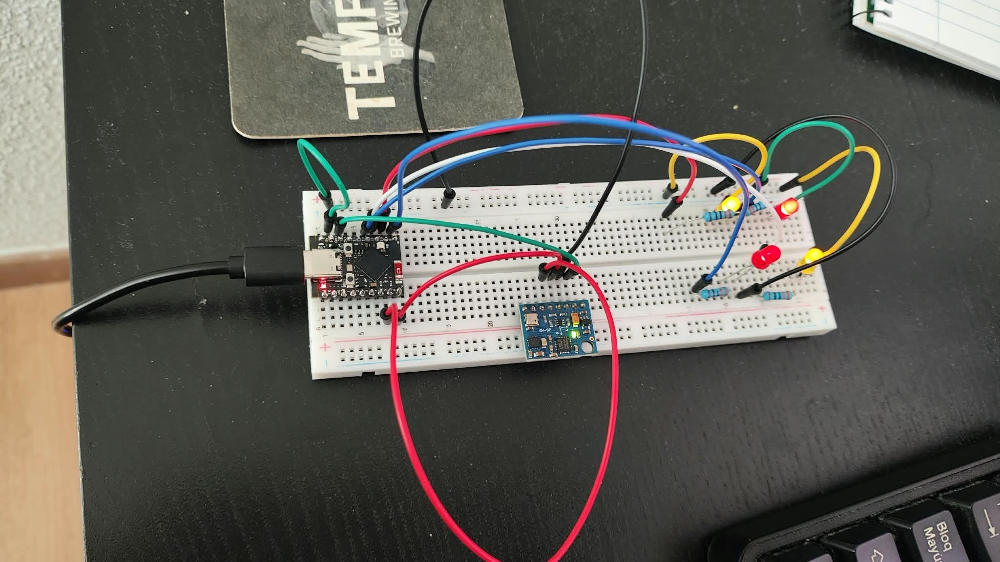

# Drone

This is my second project, and it is more MCU-dependent. I need to learn C++, ESP32, RTOS, and the Bluetooth (BLE) protocol.  
I'm using the Bitcraze frame shape to design the PCB, along with two official components: the motors and propellers.

## Objective
Build a flying drone that can handle input from a controller and hover in one place.

## First step (Schematic)
Create a first draft of the schematic: battery, 3.3V voltage regulator, an ESP32, MOSFETs, motors, and an IMU sensor (GY-87).

## Second step (Desk Prototype)
First, I needed to migrate the driver I wrote for the GY-87 from Arduino libraries to native Espressif ESP-IDF so I can use it in the Drone project.  
After that, I configured the GPIO pins to manage I2C and the PWM outputs to the MOSFETs with their timers and channels.  
The final configuration step was the Bluetooth protocol. This was more complex than I expected; it's working, though I don't feel completely confident with it yet.

Once all the I/O was configured, the next step was calculating the inputs needed to keep the drone flying.

Using LEDs with different colors to simulate the motors (CW and CCW):  
